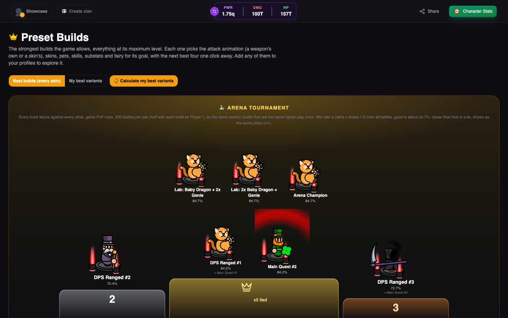
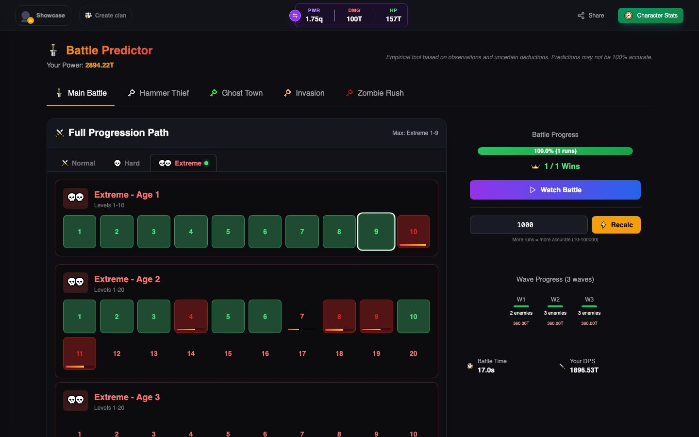
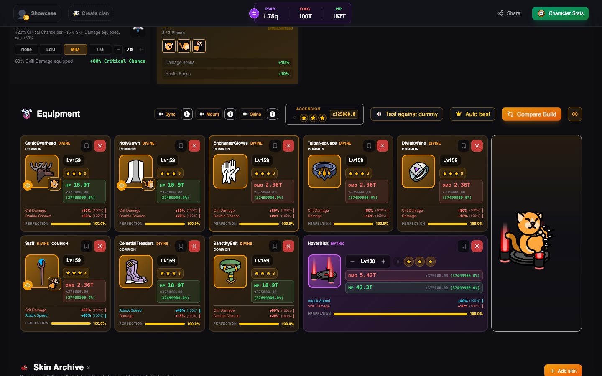
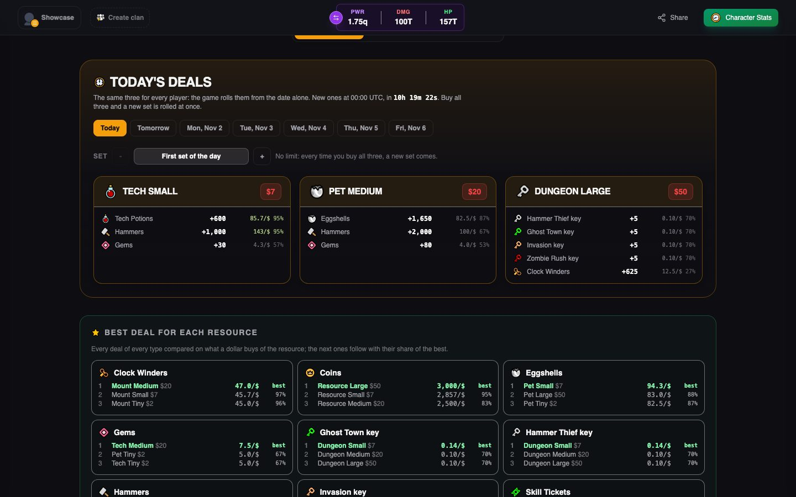

<div align="center">


# Forge Master Calculator & Wiki

**The fan-made companion for Forge Master: plan your build, simulate every battle, and look up anything in the game.**

[](https://1vcian.me/fm)
[](https://github.com/1vcian/fm/stargazers)
[](./LICENSE)
[](https://deepwiki.com/1vcian/fm)
[](https://www.buymeacoffee.com/1vcian)

[Open the app](https://1vcian.me/fm) · [Report a bug](https://github.com/1vcian/fm/issues) · [Ask the AI DeepWiki](https://deepwiki.com/1vcian/fm)

</div>

---

<table>
  <tr>
    <td width="50%"></td>
    <td width="50%"></td>
  </tr>
  <tr>
    <td align="center"><b>Preset Builds</b><br/><sub>The strongest builds the game allows, ranked in an arena tournament</sub></td>
    <td align="center"><b>Battle Predictor</b><br/><sub>How far your build gets in the main quest and every dungeon</sub></td>
  </tr>
  <tr>
    <td width="50%"></td>
    <td width="50%"></td>
  </tr>
  <tr>
    <td align="center"><b>Your profile</b><br/><sub>Every item, skin, pet and mount, drawn as in battle</sub></td>
    <td align="center"><b>Shop predictor</b><br/><sub>Today's daily deals and what a dollar buys in each pack</sub></td>
  </tr>
</table>

## Why this tool

- **Straight from the game files.** Every number comes from the game's own configuration, parsed for every game version since January 2026. When the game updates, the app follows, and the Configs page shows what changed between versions.
- **A battle engine checked against the game.** Main quest, dungeons, missions and PvP run on one combat engine, rebuilt from the game's compiled code: timings, collisions, skills, projectiles and damage formulas.
- **Nothing to install, nothing to sign up for.** It runs in your browser and keeps your profiles there. An account is optional and only syncs your profiles across devices and enables clans.

## Features

### Your build

- **Profile**: equipment with substats, skins and sets, pets, mount, skills, tech trees, fairy and ascensions, with the character drawn as it looks in battle. Keep several profiles, clone them and share them as a link.
- **AutoSync**: upload your in-game screenshots and the app reads your gear, pets, mount and resources, letting you review every change.
- **Compare Build**: try a different setup side by side and see what changes in every stat.
- **AUTO BEST** and **Substats Calculator**: search the best skills, pets, mount, fairy, skins and substats for damage or for simulated PvP.
- **Test against dummy** and **DPS breakdown**: your real damage and healing per second, measured by the combat engine.

### Simulators

- **Preset Builds**: the strongest builds for power, DPS, HPS and the main quest, with their exact equivalents. Calculate your best variants with only the skins you own, fight against every build in an arena tournament, and add any of them to your profiles.
- **Battle Predictor**: where your build really gets in the main quest (every difficulty) and in each dungeon, with how close you get on the battles you lose. Runs in parallel in the background and picks up where you were last time.
- **Mission Calculator** and **PvP Simulator**: missions with their timer, and arena fights against a saved profile or one rebuilt from a profile card screenshot.
- **Battle replays**: watch any battle drawn with the game's own sprites, skills and effects.

### Calculators

Forge (costs and odds), Offline earnings, Dungeons, Tech Tree planner, Eggs, Summons (eggs, mounts and skills), War Prizes and Substats.

### Wiki

Items, Skins and sets, Pets, Mounts, Skills, Fairies, Secondary stats, Base drop odds, Forge, Tech Tree, Arena, Guild War, Missions, **Shop** (with the daily deal predictor), Progress Pass, Unlocks and Achievements, plus a Texture Gallery and the raw game configs.

### Clans

Create or join a clan, share your build with your clanmates, keep the clan tech tree in sync and plan who attacks whom in the guild war, with push notifications.

### Images Maker

Design your clan emblem, or dress up a character with any item, skin, mount, pets and fairy and export it as a PNG or a looping GIF.

## Run it locally

You need [Node.js](https://nodejs.org) 18 or newer.

```bash
git clone https://github.com/1vcian/fm.git
cd fm
npm install
npm run dev
```

| Command | What it does |
| --- | --- |
| `npm run dev` | Starts the dev server (it refreshes the game data manifest first). |
| `npm run build` | Type checks and builds the site into `dist/`. |
| `npm run lint` | Runs ESLint. |
| `npx tsx scripts/build_presets.ts` | Regenerates the Preset Builds for the latest game data. |

**Accounts, clans and push notifications need the project's backend**, which is not part of this repository. Without it the app runs fully in the browser, with profiles saved locally: everything else works the same.

## How it is built

- **React 18, TypeScript and Vite**, styled with **Tailwind CSS**.
- **Game data**: `public/parsed_configs/<version>/` holds the parsed configuration of each game version; `public/Texture2D/<version>/` holds the sprites and battle visuals.
- **Combat engine** ([`src/engine/`](./src/engine)): one engine for every battle, with the game code it follows cited in its comments.
- **Heavy work in web workers**: battle searches, preset variants and the shop value maths never block the page.
- **Screenshot reading** with Tesseract and an ONNX model, entirely on your device.
- **Optional backend** on Supabase for accounts, profile sync and clans (the server side is not published here).

## Contributing

Contributions are welcome: bug reports, game data corrections and pull requests.

- **Bugs**: open an [issue](https://github.com/1vcian/fm/issues) with what you expected, what you saw and, if you can, a screenshot or your shared profile link.
- **Bigger features**: open an issue first so we can agree on the direction before you spend time on it.
- **Game mechanics**: every rule in the app comes from the game files or the game's code, never from guesses. If you know a mechanic works differently, an in-game screenshot or video is the best proof.
- **Pull requests**: keep them focused, in English, and make sure `npx tsc -b` passes.

## Credits

Made with ❤️ by **[1vcian](https://github.com/1vcian)**, with the help of the community.

Special thanks to **Timbo** for his invaluable help with debugging, development and community support, and to everyone who contributed code:

<a href="https://github.com/1vcian/fm/graphs/contributors">
  
</a>

Questions or feedback: [medrihanlucian@gmail.com](mailto:medrihanlucian@gmail.com) or the [Forge Master Discord](https://discord.gg/forgemaster).

If the tool helps you, you can [buy me a coffee](https://www.buymeacoffee.com/1vcian) ☕

## License and game assets

The **source code** is released under the [MIT License](./LICENSE) (see also [NOTICE](./NOTICE)).

Forge Master's **images, sprites, textures, texts and game data** in this repository belong to their respective owners. They are **not** covered by the MIT License.

---

<sub>Forge Master Calculator is a community project. Game names, images and data belong to their respective owners.</sub>
